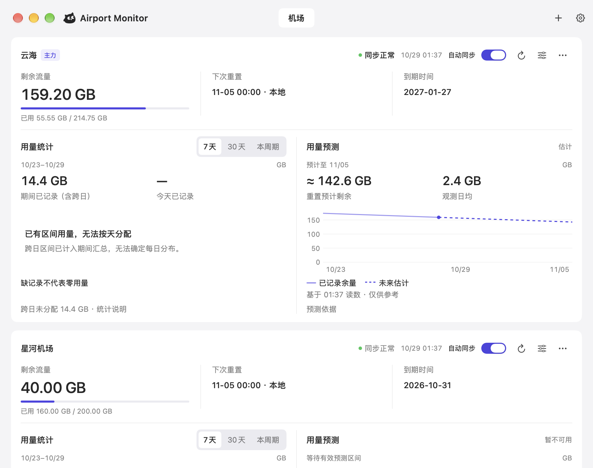
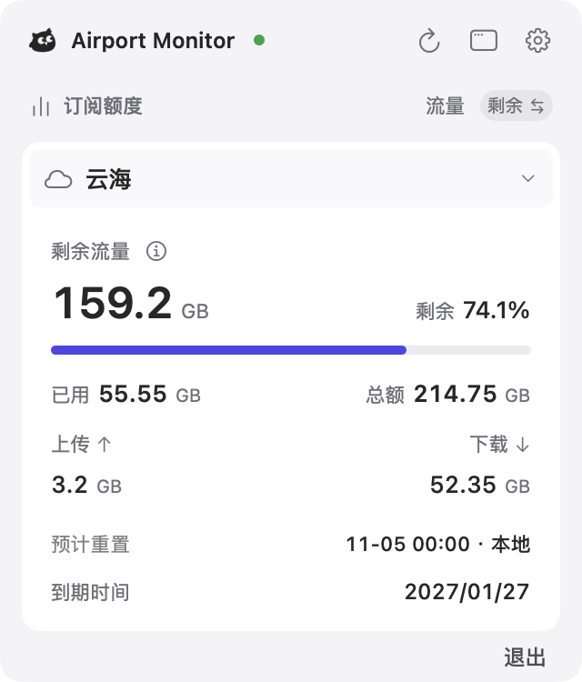

<div align="center">


# Airport Monitor

### 机场余量，一眼可见。

**剩余多少、何时重置、哪天到期。**<br>
在 Mac 菜单栏查看多个机场的套餐信息，记录用量，及时了解重置与到期。

<sub>macOS 14+ · Apple Silicon / Intel · SwiftUI 原生应用</sub>

**[快速开始](#快速开始)** &nbsp;·&nbsp; **[功能](#功能)** &nbsp;·&nbsp; **[使用说明](docs/USAGE.md)** &nbsp;·&nbsp; **[隐私](#隐私)**

<br>

<picture>
  <source media="(prefers-color-scheme: dark)" srcset="docs/images/main-window-dark.png">
  
</picture>

<sub>主窗口 · 截图使用合成演示数据，预测示意不代表实际预测资格</sub>

</div>

## Airport Monitor 能做什么？

Airport Monitor 将多个机场的套餐信息集中在菜单栏和主窗口，方便查看余量、重置和到期时间。

- **查看余量。** 菜单栏显示主力机场的剩余流量，点开即可查看套餐明细。
- **管理多个机场。** 每个机场独立保存订阅、重置规则、提醒和历史。
- **回看用量。** 查看观测记录和统计；数据满足条件时，参考用量预测。
- **接收提醒。** 按机场设置低余量、预计不足和到期提醒。

应用需要一个通过 HTTPS 提供 `subscription-userinfo` 响应头的订阅链接。它读取服务端的套餐流量计数，不接管代理、不导入节点，也不依赖特定代理客户端。

订阅读数可能包含其他设备的用量，并受服务商统计方式影响。同一地址至少间隔 72 小时读取一次，因此这里展示的是套餐余量和历史变化，而非实时网速。

## 快速开始

**1 · 获取并打开。** 需要 macOS 14 或更新版本。如有可用的发布版本，可从 [GitHub Releases](https://github.com/lzm0x219/airport-monitor/releases) 下载；也可使用 Xcode 26 或更新版本从源码构建：

```sh
git clone https://github.com/lzm0x219/airport-monitor.git
cd airport-monitor
open AirportMonitor.xcodeproj
```

在 Xcode 中选择 **AirportMonitor → My Mac**，按 **⌘R**。

<sub>默认构建和 CI 产物使用 ad-hoc 签名，未做 Developer ID 签名和 Apple 公证。终端构建、产物位置和测试方式见[构建说明](docs/USAGE.md#用-xcode-打开编译)。</sub>

**2 · 添加机场。** 点击主窗口右上角的「＋」，粘贴订阅链接并点击「读取」。核对预览，填写机场名称并确认添加。添加后可在机场配置中设置重置规则和提醒。

**3 · 在菜单栏查看。** 点击猫头鹰图标查看余量、重置和到期时间。关闭主窗口后，应用仍留在菜单栏；显示样式、单位和同步间隔可在设置中调整。

添加时的读取也计入 72 小时间隔，之后不能立即再次刷新。应用会显示已知的最早刷新时间。

## 功能

### 菜单栏里的套餐信息

菜单栏支持图标与余额、仅余额或仅图标。点开面板，即可查看剩余与已用流量、总额、上传与下载，以及下次重置和到期时间；也可以切换机场、同步或打开主窗口。

<p align="center">
  <picture>
    <source media="(prefers-color-scheme: dark)" srcset="docs/images/menu-panel-dark.png">
    
  </picture><br>
  <sub>菜单栏面板 · 截图使用合成数据</sub>
</p>

### 多个机场，各自管理

每个机场独立保存配置和历史，支持暂停、归档和恢复。主窗口可以浏览其他机场，菜单栏仍显示你选定的主力机场。

重置规则支持每月固定日、按购买日或指定一次时间。未配置时显示「未设置」，不会根据到期时间或流量回落猜测重置日。

### 用量记录与预测

查看 7 天、30 天或本周期的用量统计，回看每日记录与同步记录。首次读取建立基线；没有观测到的每日用量不会补成零，跨日差额也不会被拆成每天的数据。

数据足够时，主窗口提供采样后预测。按 72 小时间隔采样，至少需要 4 次可比较读数、跨度达到 9 天，并满足重置规则等有效性条件。预测仅供参考，具体口径见[用量统计与预测](docs/USAGE.md#用量统计与预测)。

### 按机场设置提醒

支持低余量、预计不足和到期提醒，通过 macOS 通知交付。预计不足提醒有独立的连续预测条件，仅靠 72 小时采样无法满足；主窗口的预测不会直接触发该提醒。详见[提醒说明](docs/USAGE.md#提醒)。

## 同步方式

自动同步默认每 **72 小时**一次，也可选择 **7 天**。同一订阅地址的添加预览、手动同步和失败重试共用 72 小时限频，重启后仍有效；请求发起后的失败或取消也计入间隔。

读数超过 30 分钟会标为上次读数。同步失败时保留已有数据并显示错误；Mac 休眠或应用退出期间不会采样。

## 隐私

订阅链接保存在本机登录钥匙串，机场配置、流量历史和设置保存在本机。应用没有分析服务、远程遥测或 iCloud 同步。

请求只发往你填写的订阅地址及其 HTTPS 重定向目标。应用读取响应头后取消正文下载，不解析或保存节点列表；系统仍可能收到少量已在途正文。

存储位置、历史保留和损坏数据的恢复方式见[隐私、存储与故障恢复](docs/USAGE.md#隐私存储与故障恢复)。

## 常见问题

**为什么刚添加后不能立即刷新？** 添加时的预览也是一次请求。同一订阅地址的下一次请求至少需要等待 72 小时。

**为什么图表有空白或没有预测？** 缺失的每日数据不会补零；预测需要足够的可比较读数和有效的重置规则。详见[使用说明](docs/USAGE.md#常见问题)。

## 文档

| 文档 | 内容 |
| :-- | :-- |
| [使用说明](docs/USAGE.md) | 日常配置、数据口径、构建和常见问题 |
| [产品范围](PRODUCT.md) | 产品用途、能力与约束 |
| [设计规范](DESIGN.md) | 界面、交互与原生实现约定 |
| [验证记录](docs/VALIDATION.md) | 构建、测试和实机验证的范围与限制 |
| [构建与发布](docs/release.md) | 自动构建、发布草稿与签名限制 |
| [目录与文件规范](docs/project-structure.md) | 源码、资源、文档和临时文件的归属 |

## 许可证

本项目采用 [MIT 许可证](LICENSE)。
